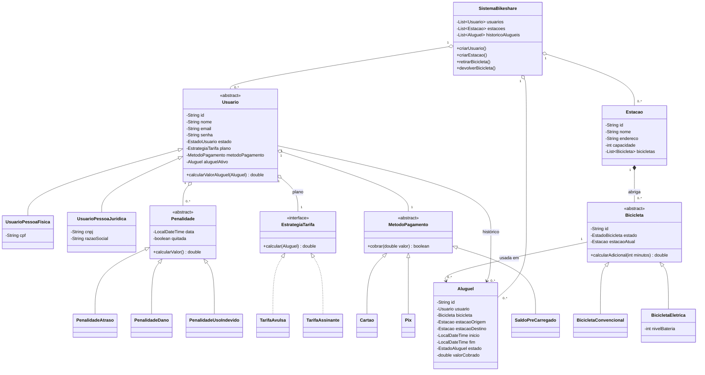
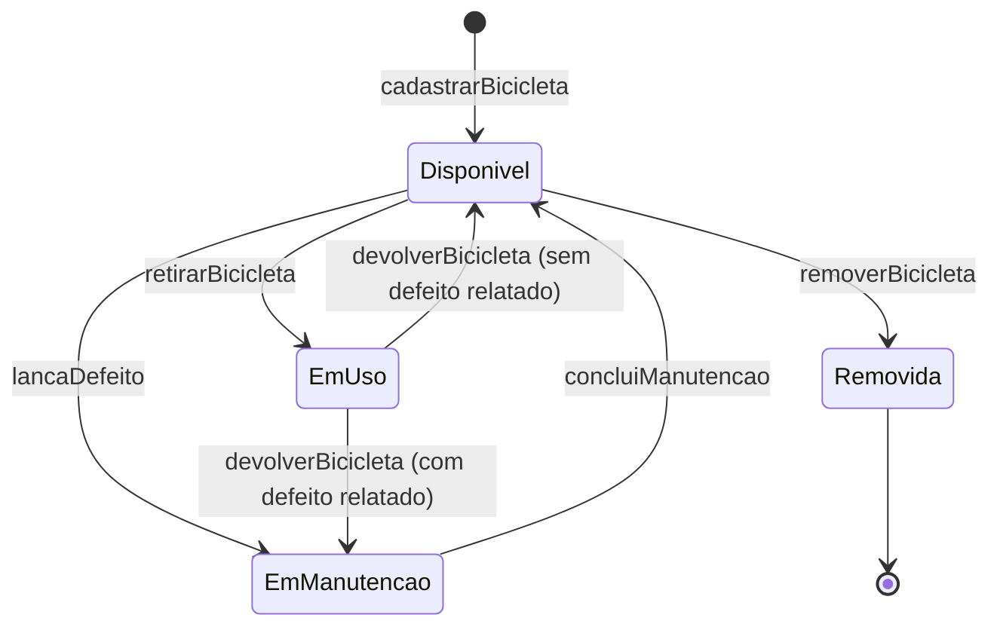
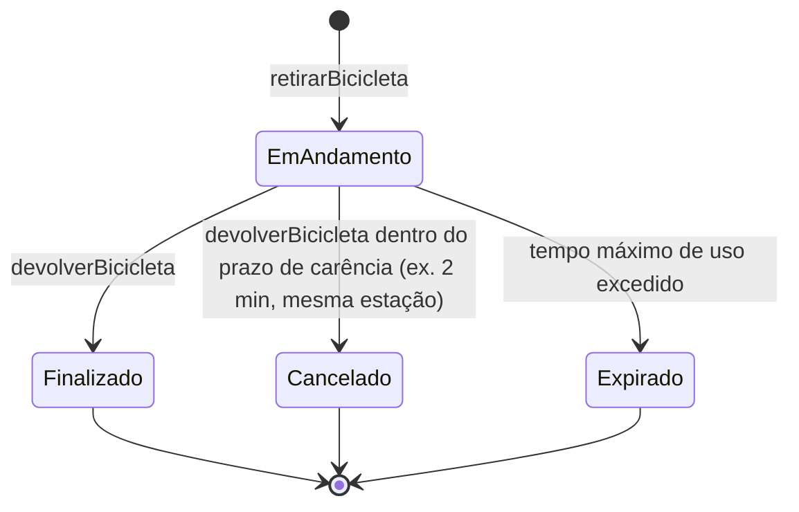
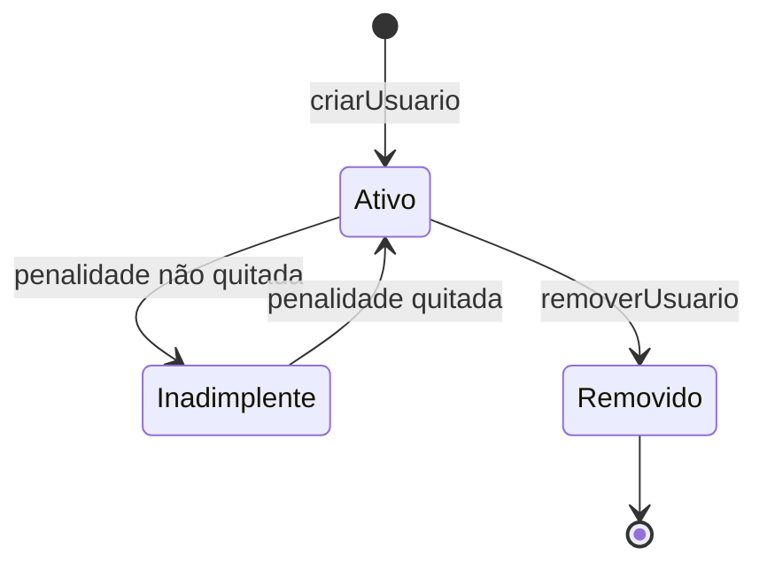

# Sistema de Compartilhamento de Bicicletas (BIKESHARE)

> **Documento de proposta** elaborado pelo monitor da disciplina de Programação 2 (Ciências da Computação — UFAL), para apreciação do professor, nos moldes do projeto **WePayU** usado em semestres anteriores. Inspirado conceitualmente no domínio de bicicletas compartilhadas urbanas (ex.: projeto `ruantmelo/bikeshare`) e na estrutura metodológica do `TETEURYAN/WePayUPOO` (análise pronta + testes de aceitação executáveis via **EasyAccept**).

---

## 1. Descrição Geral

Assim como o WePayU tinha por propósito construir um sistema de folha de pagamento, o **BIKESHARE** tem por propósito construir um sistema de gerenciamento de um serviço de bicicletas compartilhadas (bike-sharing), no estilo dos sistemas usados em várias cidades brasileiras (ex.: Bike Itaú, Tembici).

O sistema mantém um cadastro de **usuários**, **estações** (pontos de retirada/devolução) e **bicicletas**. Um usuário retira uma bicicleta disponível em uma estação, usa-a por um período (um **aluguel**, também chamado de "corrida") e a devolve em qualquer estação com vaga livre. O sistema deve:

- Controlar a disponibilidade de bicicletas em cada estação (bicicletas presentes × vagas livres);
- Impedir a retirada de bicicletas indisponíveis (em uso, em manutenção) e de estações sem bicicletas;
- Impedir a devolução em estações sem vagas;
- Calcular o valor a cobrar por cada aluguel, de acordo com o **plano** do usuário (avulso ou assinante) e com a duração da corrida;
- Impedir que um usuário **inadimplente** (com pendências financeiras) faça uma nova retirada;
- Impedir que um usuário com um aluguel em andamento inicie um segundo aluguel simultâneo;
- Registrar o histórico de aluguéis de cada usuário e gerar relatórios (faturamento, bicicletas disponíveis/alugadas);
- Permitir desfazer/refazer operações (undo/redo);
- Rodar de forma **totalmente desacoplada de interface gráfica** — assim como no WePayU, só será implementada a lógica de negócio, acessada por uma **Façade** e validada por scripts de teste de aceitação (EasyAccept).

Regras análogas às do WePayU (para efeito de comparação de complexidade, já que este documento é derivado daquele):

| WePayU | BIKESHARE |
|---|---|
| Empregado horista / assalariado / comissionado (tipos com regras de pagamento diferentes) | Usuário avulso / assinante (planos com regras de tarifação diferentes) |
| Cartão de ponto | Aluguel/corrida (registra início e fim) |
| Resultado de venda → comissão | Duração da corrida → tarifa cobrada |
| Sindicato cobra taxa mensal + taxas de serviço avulsas | Plano de assinatura cobra mensalidade + penalidades avulsas (atraso, dano) |
| `rodaFolha` roda a folha de pagamento para uma data | Não há "rodada" — cada aluguel é cobrado no momento da devolução (mais simples, mas com regras próprias de bloqueio) |
| Agenda de pagamento (semanal/mensal/customizável) | Plano de tarifação (avulso/assinante/customizável) |
| Undo/redo (US8) | Undo/redo (US9) |
| `Empregado` (abstrata) → `EmpregadoHorista`/`EmpregadoAssalariado`/`EmpregadoComissionado` | `Usuario` (abstrata) → `UsuarioPessoaFisica`/`UsuarioPessoaJuridica`; `Bicicleta` (abstrata) → `BicicletaConvencional`/`BicicletaEletrica` |
| `MetodoPagamento` (abstrata) → `EmMaos`/`Banco`/`Correios` | `MetodoPagamento` (abstrata) → `Cartao`/`Pix`/`SaldoPreCarregado` |

> **Atualização de design:** a primeira versão deste documento usava apenas composição/Strategy (nenhuma hierarquia de herança concreta). A versão atual reintroduz duas hierarquias de herança "de dados" (`Usuario`, `Bicicleta`) e uma de comportamento (`MetodoPagamento`), além de uma quarta para `Penalidade` — deixando o projeto tão rico em POO quanto o WePayU, sem abrir mão do Strategy onde ele realmente se justifica (ver Seção 3).

---

## 2. Glossário

| Termo | Definição |
|---|---|
| **Usuário** | Pessoa cadastrada no sistema, identificada por um identificador único gerado automaticamente. Pode alugar bicicletas. |
| **Estação** | Ponto físico com um número fixo de vagas (`capacidade`), onde bicicletas ficam disponíveis para retirada e podem ser devolvidas. |
| **Bicicleta** | Veículo compartilhado, identificado unicamente, que pertence a uma estação enquanto não está em uso. |
| **Vaga** | Espaço disponível em uma estação para receber uma bicicleta. `vagas livres = capacidade − bicicletas presentes`. |
| **Aluguel (ou corrida)** | Período de uso de uma bicicleta por um usuário, do momento da retirada até a devolução. |
| **Plano** | Modalidade de cobrança contratada pelo usuário: *avulso* (paga por minuto/hora a cada corrida) ou *assinante* (paga mensalidade e tem franquia de minutos gratuitos). |
| **Tarifa** | Valor cobrado por um aluguel, calculado de acordo com o plano do usuário e a duração da corrida. |
| **Penalidade / taxa extra** | Cobrança adicional lançada sobre um usuário (ex.: atraso na devolução, dano à bicicleta, devolução fora da área de cobertura). Análoga à "taxa de serviço" do sindicato no WePayU. |
| **Inadimplência** | Situação de um usuário que possui pendências financeiras não quitadas; nesse estado, não pode iniciar novos aluguéis. |
| **Estado da bicicleta** | Condição operacional da bicicleta: disponível, em uso, em manutenção ou removida. |
| **Estado do aluguel** | Condição de uma corrida: em andamento, finalizada, cancelada ou expirada. |
| **Bicicleta convencional / elétrica** | Os dois tipos fixos de bicicleta suportados pelo sistema; a elétrica possui nível de bateria e cobrança adicional por minuto. |
| **Usuário pessoa física / jurídica** | Os dois tipos fixos de usuário; pessoa física se identifica por CPF, pessoa jurídica por CNPJ/razão social e pode ter fatura consolidada. |
| **Método de pagamento** | Forma pela qual o usuário paga suas cobranças: cartão, Pix ou saldo pré-carregado. |

---

## 3. Modelagem Conceitual das Entidades

Assim como recomendado no documento do WePayU, **o modelo de design (implementado em software) não precisa seguir o modelo conceitual entidade-por-entidade** — o diagrama abaixo é o ponto de partida conceitual, e as decisões de arquitetura (padrões de projeto, interfaces, etc.) podem reorganizar essas responsabilidades.



### Observações de design

**Onde há herança de verdade agora — e por quê:**

| Hierarquia | Diferença entre subtipos | Por que é herança (`extends`) e não Strategy |
|---|---|---|
| `Usuario` → `UsuarioPessoaFisica` / `UsuarioPessoaJuridica` | Documento diferente (CPF × CNPJ), forma de faturamento diferente (individual × consolidada) | É uma diferença **estrutural**, fixa desde o cadastro — o usuário não "vira" pessoa jurídica em tempo de execução. |
| `Bicicleta` → `BicicletaConvencional` / `BicicletaEletrica` | Elétrica tem `nivelBateria` e sobrescreve `calcularAdicional()` para cobrar um valor extra por minuto | O tipo físico do veículo é fixo desde que é cadastrado na estação. |
| `MetodoPagamento` → `Cartao` / `Pix` / `SaldoPreCarregado` | Cada um sobrescreve `cobrar()` com sua própria lógica | Espelha quase 1:1 a hierarquia `MetodoPagamento` do WePayU. |
| `Penalidade` → `PenalidadeAtraso` / `PenalidadeDano` / `PenalidadeUsoIndevido` | Cada uma sobrescreve `calcularValor()` de forma diferente | O motivo da penalidade é conhecido no momento em que ela é criada e não muda depois. |

**Onde continua sendo Strategy (composição), e por quê:** `Usuario.plano` continua sendo uma referência a `EstrategiaTarifa` (interface), não uma subclasse — porque novos planos podem ser **criados em tempo de execução** pela direção da empresa (US12, `criarPlano`), com parâmetros vindos de fora (franquia, valor por minuto), exatamente como o WePayU cria novas agendas de pagamento customizadas a partir de uma string (`criarAgendaDePagamentos descricao="semanal 3 3"`) em vez de uma nova subclasse de `Empregado`. Essa é a mesma distinção que o WePayU já ensinava: **herança para "é um" fixo e conhecido em tempo de compilação; Strategy/composição para comportamento plugável em tempo de execução.**

Outras observações:
- **`Bicicleta.estacaoAtual`** é `null` enquanto a bicicleta está em uso (fora de qualquer estação).
- **`Aluguel.estacaoDestino`** só é preenchido na devolução.
- **`Usuario.metodoPagamento`** é obrigatório antes da primeira retirada com cobrança pendente (ver regra de negócio 11, Seção 5).
- Uma hierarquia adicional, não representada no diagrama de classes por convenção (fica em `exception/`), é recomendada para as exceções de negócio: uma `BikeshareException` abstrata da qual herdam `EstacaoCheiaException`, `BicicletaIndisponivelException`, `UsuarioInadimplenteException`, etc. — reforça herança em um contexto diferente (tratamento de erros) e ajuda a manter consistentes as mensagens que o EasyAccept verifica.

---

## 4. Máquinas de Estado

O professor pediu explicitamente para avaliar a máquina de estados — ela é o núcleo do domínio do BIKESHARE (mais até do que no WePayU) e um ótimo motivador natural para o **padrão State**.

### 4.1 Estado da Bicicleta



**Regras de transição:**
- Só é possível `retirarBicicleta` se o estado for `Disponivel` (e a estação tiver essa bicicleta).
- `devolverBicicleta` só é possível se o estado atual for `EmUso`.
- Uma bicicleta em `EmManutencao` não aparece como disponível em nenhuma estação e não pode ser retirada.
- `removerBicicleta` só é permitida em `Disponivel` (não se remove bicicleta em uso).

### 4.2 Estado do Aluguel (Corrida)



**Regras de transição:**
- Um usuário só pode ter **um** aluguel em `EmAndamento` por vez.
- `Cancelado` é um caso especial de devolução: se o usuário devolve a bicicleta na mesma estação dentro de uma janela curta (ex.: 2 minutos), a corrida é cancelada e não gera cobrança — regra comum em sistemas reais de bike-sharing, útil para exercitar uma condição de borda no `State`/`Strategy`.
- `Expirado` é atingido quando o sistema roda uma verificação (ou quando a devolução ocorre após um limite máximo, ex.: 24h) e gera automaticamente uma `Penalidade` sobre o usuário.

### 4.3 Estado do Usuário



**Regra de negócio central:** um usuário em `Inadimplente` **não pode** executar `retirarBicicleta` — essa é a regra de negócio análoga a validações de estado do WePayU (ex.: "não pode alterar tipo de empregado sem fornecer os atributos associados").

### 4.4 Estado (derivado) da Estação

A estação não precisa de uma máquina de estados formal com transições próprias — sua "condição" é **derivada** da contagem de bicicletas:

- **Vazia**: `bicicletas.size() == 0` → não permite `retirarBicicleta`.
- **Parcialmente ocupada**: `0 < bicicletas.size() < capacidade`.
- **Cheia**: `bicicletas.size() == capacidade` → não permite `devolverBicicleta` nessa estação.

Isso pode ser modelado como um método de consulta (`getVagasDisponiveis`) em vez de um estado com transições — vale discutir essa escolha no relatório (nem tudo que parece "estado" precisa do padrão State; aqui, um valor derivado é suficiente e mais simples).

### 4.5 Aprofundamento opcional: State como classe abstrata

As hierarquias da Seção 3 (`Usuario`, `Bicicleta`, `MetodoPagamento`, `Penalidade`) são exemplos de **herança "de dados"** — cada subtipo carrega atributos e regras diferentes, mas todos existem simultaneamente no sistema. Para os alunos que quiserem exercitar uma **segunda forma de herança** — a de **comportamento compartilhado com sobrescrita seletiva** —, recomenda-se implementar `EstadoBicicleta`/`EstadoAluguel` como **classe abstrata** (em vez de interface pura), com um método padrão por transição que lança `OperacaoInvalidaException("Operação inválida nesse estado.")`, e cada estado concreto sobrescrevendo **apenas** as transições que ele de fato permite. Isso é o mesmo espírito do "template method": a superclasse define o contrato completo, as subclasses customizam só o necessário — uma forma diferente de usar `extends` da que já aparece nas outras quatro hierarquias.

---

## 5. Regras de Negócio Detalhadas

1. Um usuário só pode iniciar um aluguel se: (a) está `Ativo` (não inadimplente); (b) não possui aluguel em `EmAndamento`; (c) a bicicleta escolhida está `Disponivel`; (d) a bicicleta está de fato na estação informada.
2. Um aluguel só pode ser devolvido se: (a) a estação de destino tem vaga livre; (b) o aluguel informado está `EmAndamento`.
3. O valor cobrado é calculado na devolução, de acordo com o plano do usuário:
   - **Avulso**: tarifa fixa de liberação + valor por minuto excedente (parametrizável).
   - **Assinante**: mensalidade fixa cobrada à parte (não neste fluxo) + franquia de minutos grátis por corrida (ex.: 60 min) + valor por minuto excedente após a franquia.
4. Corridas dentro do prazo de carência (mesma estação, poucos minutos) não geram cobrança (`Cancelado`).
5. Corridas que ultrapassam o tempo máximo de uso (ex.: 24h sem devolução) tornam-se `Expirado` e geram uma `Penalidade` automática, além de marcar a bicicleta como `EmManutencao` (assume-se possível problema).
6. Penalidades não quitadas tornam o usuário `Inadimplente`.
7. O sistema deve impedir a devolução em estação cheia — o aluguel permanece `EmAndamento` até haver vaga em alguma estação.
8. A identificação de usuário no sistema é gerada automaticamente (não é fornecida pelo operador), assim como no WePayU (US1).
9. `BicicletaEletrica` cobra um valor adicional por minuto de uso (parametrizável) e não pode ser retirada se `nivelBateria` estiver abaixo de um mínimo configurável (ex.: 15%) — nesse caso o sistema deve rejeitá-la como se estivesse indisponível.
10. `UsuarioPessoaJuridica` pode registrar uma `razaoSocial` e um `cnpj`; a forma de consolidar cobranças de múltiplos colaboradores vinculados (se o professor decidir incluir esse refinamento) fica a critério do grupo, desde que documentada no relatório — cada aluguel continua sendo registrado individualmente por usuário.
11. Toda retirada com cobrança pendente exige que o usuário tenha um `MetodoPagamento` válido cadastrado; sem isso, a retirada deve ser recusada com uma mensagem específica.

> Esses parâmetros (valores de tarifa, tempo de carência, tempo máximo, franquia) devem ficar **configuráveis**, não *hard-coded* — outro gancho natural para os alunos explorarem no design (ex.: injeção de estratégia, arquivo de configuração).

---

## 6. User Stories

Numeração e formato inspirados diretamente no documento do WePayU (para manter familiaridade com os alunos que já viram esse padrão de user story).

| US | Título | Descrição Breve |
|---|---|---|
| 1 | Cadastro de usuário | Um novo usuário é adicionado ao sistema, informando nome, email, senha, tipo (`pessoaFisica`/`pessoaJuridica`) e os atributos associados (`cpf`, ou `cnpj`+`razaoSocial`), além de plano (avulso por padrão). Um identificador único é gerado automaticamente. |
| 2 | Consulta de usuário | Recupera atributos de um usuário cadastrado (nome, email, tipo, plano, estado, etc.) a partir do seu identificador. |
| 3 | Alteração de usuário | Altera atributos de um usuário já cadastrado: nome, email, senha, plano, método de pagamento (cartão/Pix/saldo pré-carregado, com os atributos associados a cada um). |
| 4 | Remoção de usuário | Remove um usuário do sistema (não deve ser possível remover usuário com aluguel em andamento). |
| 5 | Cadastro de estação | Uma nova estação é criada, com nome, endereço e capacidade (número de vagas). |
| 6 | Gestão de bicicletas na estação | Adiciona ou remove bicicletas de uma estação, informando o tipo (`convencional`/`eletrica`) e os atributos associados (`nivelBateria` para elétricas), respeitando a capacidade disponível. |
| 7 | Consulta de disponibilidade | Consulta quantas bicicletas estão disponíveis e quantas vagas livres existem em uma estação. |
| 8 | Retirada de bicicleta | Um usuário retira uma bicicleta disponível de uma estação, iniciando um aluguel; a bicicleta passa a `EmUso` e o aluguel a `EmAndamento`. |
| 9 | Devolução de bicicleta | Um usuário devolve a bicicleta em uma estação com vaga livre, finalizando o aluguel, calculando e registrando o valor cobrado. |
| 10 | Consulta de histórico | Consulta o histórico de aluguéis de um usuário (datas, estações, valores cobrados). |
| 11 | Planos e tarifação | Usuários podem contratar um plano (avulso/assinante); o sistema calcula o valor do aluguel de acordo com o plano vigente no momento da devolução. |
| 12 | Criação de novos planos de tarifação | A direção da empresa pode criar novas modalidades de plano (com parâmetros próprios de franquia/valor por minuto) e disponibilizá-las aos usuários. |
| 13 | Regras de bloqueio | O sistema impede retirada por usuário inadimplente, retirada de bicicleta indisponível/estação vazia e devolução em estação cheia, respondendo com mensagens de erro apropriadas. |
| 14 | Lançamento e conclusão de manutenção | O sistema registra um defeito relatado em uma bicicleta (que passa a `EmManutencao`) e permite concluir a manutenção (retorno a `Disponivel`). |
| 15 | Relatórios | Gera relatórios de bicicletas disponíveis/alugadas por estação e faturamento total em um intervalo de datas. |
| 16 | Undo/redo | Qualquer transação associada às User Stories 1 a 15 pode ser desfeita (undo) ou refeita (redo). |

---

## 7. Linguagem de Script (comandos para os testes de aceitação)

Seguindo exatamente o mesmo espírito da linguagem do WePayU (cada comando corresponde a um método da Façade, acionado pelo EasyAccept):

```
<void>   zerarSistema
<String> criarUsuario nome=<String> email=<String> senha=<String> tipo=pessoaFisica cpf=<String>
<String> criarUsuario nome=<String> email=<String> senha=<String> tipo=pessoaJuridica cnpj=<String> razaoSocial=<String>
<String> criarUsuario nome=<String> email=<String> senha=<String> tipo=pessoaFisica cpf=<String> plano=assinante mensalidade=<String>
<void>   alterarUsuario usuario=<String> atributo=<String> valor=<String>
<void>   alterarUsuario usuario=<String> atributo=metodoPagamento valor1=cartao numero=<String> validade=<String>
<void>   alterarUsuario usuario=<String> atributo=metodoPagamento valor1=pix chave=<String>
<void>   alterarUsuario usuario=<String> atributo=metodoPagamento valor1=saldoPreCarregado
<void>   removerUsuario usuario=<String>
<String> getAtributoUsuario usuario=<String> atributo=<String>
<String> getUsuarioPorEmail email=<String>

<String> criarEstacao nome=<String> endereco=<String> capacidade=<String>
<void>   adicionarBicicleta estacao=<String> bicicleta=<String> tipo=convencional
<void>   adicionarBicicleta estacao=<String> bicicleta=<String> tipo=eletrica nivelBateria=<String>
<void>   removerBicicleta estacao=<String> bicicleta=<String>
<String> getBicicletasDisponiveis estacao=<String>
<String> getVagasDisponiveis estacao=<String>
<String> getEstadoBicicleta bicicleta=<String>

<String> retirarBicicleta usuario=<String> estacao=<String> bicicleta=<String> data=<String>
<void>   devolverBicicleta aluguel=<String> estacao=<String> data=<String>
<String> getAtributoAluguel aluguel=<String> atributo=<String>
<String> getHistoricoAlugueis usuario=<String>

<void>   lancaDefeito bicicleta=<String> descricao=<String>
<void>   concluiManutencao bicicleta=<String>

<String> criarPlano nome=<String> franquiaMinutos=<String> valorMinutoExcedente=<String> mensalidade=<String>
<String> getTotalFaturado dataInicial=<String> dataFinal=<String>

<void>   undo
<void>   redo
<void>   encerrarSistema
```

Assim como no WePayU, `criarUsuario` e `criarEstacao` retornam o identificador gerado, e os comandos `get*` devem lançar exceção com mensagem clara quando a entidade não existir ou o atributo for inválido — esse comportamento (mensagens de erro) costuma ser exatamente o que os testes de aceitação verificam com mais rigor.

---

## 8. Milestones

A avaliação da disciplina define **AB1** e **AB2**, com a observação de que **"no Milestone 2, todas as user stories serão testadas"**. Proposta de divisão, no mesmo espírito do WePayU (US 1–8 no primeiro milestone):

### Milestone 1 — AB1 (User Stories 1 a 9)

Cadastro/consulta/alteração/remoção de usuários e estações, gestão de bicicletas, retirada e devolução simples (sem tarifação diferenciada ainda — pode-se usar uma tarifa única fixa neste milestone).

**Entregáveis:**
- Código-fonte documentado no repositório GitHub;
- Façade cobrindo os comandos das US 1–9;
- Testes de aceitação `us1.txt` a `us9.txt` (e variações `_1`, `_2` para casos de exceção) passando;
- Início do relatório: descrição arquitetural e ao menos 1–2 padrões de projeto já aplicados (ex.: Facade, State).

### Milestone 2 — AB2 (User Stories 1 a 16 — todas)

Planos de tarifação diferenciados (Strategy), regras de bloqueio (inadimplência, estações cheias/vazias), manutenção, relatórios, undo/redo e persistência dos dados entre execuções.

**Entregáveis:**
- Todas as User Stories testadas e passando (peso de 50% da nota, conforme critério do professor);
- Relatório completo, com uma seção por padrão de projeto adotado (nome, descrição geral, problema resolvido, identificação da oportunidade, aplicação no projeto);
- Persistência dos dados (o sistema deve reabrir com o estado da última execução, análogo à recomendação de `XMLEncoder`/`XMLDecoder` do WePayU);
- Testado em máquina diferente da usada no desenvolvimento.

> Fica a critério do professor decidir se prefere subdividir em mais de dois milestones intermediários (como o rascunho de 6 blocos originalmente esboçado) apenas como *checkpoints informais* de acompanhamento, mantendo a nota oficial concentrada em AB1/AB2.

---

## 9. Padrões de Projeto Sugeridos

Antes dos padrões de projeto (GoF) propriamente ditos, vale registrar no relatório que o desenho da Seção 3 já exercita diretamente os **pilares de orientação a objetos** — o que não é, por si só, um "padrão de projeto" formal, mas é exatamente o que o critério "Qualidade do Design" tende a olhar primeiro:

- **Herança + polimorfismo (dados)**: `Usuario` → `UsuarioPessoaFisica`/`UsuarioPessoaJuridica`; `Bicicleta` → `BicicletaConvencional`/`BicicletaEletrica`; `MetodoPagamento` → `Cartao`/`Pix`/`SaldoPreCarregado`; `Penalidade` → `PenalidadeAtraso`/`PenalidadeDano`/`PenalidadeUsoIndevido`.
- **Herança + polimorfismo (comportamento/template method)**: `EstadoBicicleta`/`EstadoAluguel` implementados como classe abstrata com transições padrão que só são sobrescritas onde fazem sentido (Seção 4.5).
- **Abstração e encapsulamento**: atributos privados em todas as entidades, acesso mediado pela Façade.
- **Composição/agregação**: `SistemaBikeshare` agregando `Usuario`/`Estacao`/`Aluguel`; `Estacao` compondo `Bicicleta`.

Com essa base, os seguintes padrões de projeto surgem **organicamente** dos requisitos (não à força). Para cada um, os alunos devem preencher no relatório os tópicos exigidos (descrição geral, problema resolvido, identificação da oportunidade, aplicação no projeto).

| Padrão | Onde surge naturalmente |
|---|---|
| **Facade** | Ponto de acesso único da lógica de negócio para o EasyAccept — obrigatório, como no WePayU. |
| **Factory Method** | Instanciar o subtipo correto de `Usuario`, `Bicicleta` ou `MetodoPagamento` a partir do parâmetro `tipo=<String>` recebido pela Façade — recomendado (não mais opcional), já que agora há três hierarquias concretas de classes para instanciar dinamicamente a partir de uma string, exatamente como o `criarEmpregado` do WePayU faz implicitamente. |
| **State** | Estado da `Bicicleta` (Disponível/EmUso/EmManutenção/Removida) e do `Aluguel` (EmAndamento/Finalizado/Cancelado/Expirado); evita cadeias de `if`/`switch` espalhadas para validar transições. |
| **Strategy** | Cálculo do valor do aluguel — cada `Plano` (`EstrategiaTarifa`: avulso, assinante, e novos planos criados via US12) implementa sua própria forma de calcular a tarifa, para os casos em que o tipo é definido em tempo de execução (diferente das hierarquias de herança acima, que são fixas). |
| **Command + Memento** | Undo/redo (US16) — cada operação que altera o sistema (criar usuário, retirar bicicleta, etc.) é encapsulada como um comando reversível; o Memento guarda o snapshot necessário para desfazer. |
| **Observer** | (Opcional, ganho extra) Notificar interessados quando uma estação fica cheia/vazia, ou quando uma bicicleta muda de estado — útil para desacoplar regras de bloqueio de eventuais logs/relatórios. |

Não é obrigatório usar todos — o professor pode definir um mínimo (ex.: 3 padrões, sendo Facade obrigatório) alinhado ao que já era praticado no WePayU. Recomenda-se, porém, que o relatório discuta explicitamente **por que** cada hierarquia da Seção 3 usa herança e **por que** `EstrategiaTarifa` usa Strategy — essa comparação (tipo fixo × comportamento plugável em tempo de execução) costuma valer mais pontos de "Qualidade do Design" do que simplesmente listar padrões aplicados.

---

## 10. Arquitetura e Estrutura de Pacotes Sugerida

Seguindo o princípio já reforçado no documento do WePayU — **nenhuma lógica de negócio na interface, porque não haverá interface** — e separando claramente os artefatos de teste de aceitação:

```
br.ufal.ic.p2.bikeshare
 ├── facade/             (Facade — único ponto de entrada para o EasyAccept)
 ├── model/              (Usuario e subtipos, Estacao, Bicicleta e subtipos, Aluguel)
 ├── model/pagamento/    (MetodoPagamento, Cartao, Pix, SaldoPreCarregado)
 ├── model/penalidade/   (Penalidade, PenalidadeAtraso, PenalidadeDano, PenalidadeUsoIndevido)
 ├── model/state/        (EstadoBicicleta, EstadoAluguel e implementações)
 ├── model/tarifa/       (EstrategiaTarifa, TarifaAvulsa, TarifaAssinante)
 ├── factory/            (fábricas para instanciar subtipos a partir de tipo=<String>)
 ├── command/            (Command, Memento — para undo/redo)
 ├── persistence/        (leitura/escrita do estado do sistema em XML/JSON)
 └── exception/          (BikeshareException e subclasses de exceções de negócio)
```

Estrutura de repositório (espelhando o WePayUPOO):

```
BIKESHARE/
 ├── src/                 (código-fonte)
 ├── tests/               (us1.txt ... us16.txt, com variações _1, _2 para exceções)
 ├── lib/                 (easyaccept.jar e demais dependências)
 ├── relatorio/           (relatório em PDF, conforme exigido na entrega)
 └── README.md
```

### `Main.java` de execução dos testes (adaptado do WePayU)

```java
import easyaccept.EasyAccept;

public class Main {
    public static void main(String[] args) {
        String facade = "br.ufal.ic.p2.bikeshare.Facade";
        EasyAccept.main(new String[]{facade, "tests/us1.txt"});
        EasyAccept.main(new String[]{facade, "tests/us1_1.txt"});
        EasyAccept.main(new String[]{facade, "tests/us2.txt"});
        EasyAccept.main(new String[]{facade, "tests/us3.txt"});
        EasyAccept.main(new String[]{facade, "tests/us4.txt"});
        EasyAccept.main(new String[]{facade, "tests/us5.txt"});
        EasyAccept.main(new String[]{facade, "tests/us6.txt"});
        EasyAccept.main(new String[]{facade, "tests/us7.txt"});
        EasyAccept.main(new String[]{facade, "tests/us8.txt"});
        EasyAccept.main(new String[]{facade, "tests/us9.txt"});
        EasyAccept.main(new String[]{facade, "tests/us10.txt"});
        EasyAccept.main(new String[]{facade, "tests/us11.txt"});
        EasyAccept.main(new String[]{facade, "tests/us12.txt"});
        EasyAccept.main(new String[]{facade, "tests/us13.txt"});
        EasyAccept.main(new String[]{facade, "tests/us14.txt"});
        EasyAccept.main(new String[]{facade, "tests/us15.txt"});
        EasyAccept.main(new String[]{facade, "tests/us16.txt"});
    }
}
```

---

## 11. Persistência

Sem uso de banco de dados (como no WePayU): o estado completo do sistema (`usuarios`, `estações`, `bicicletas`, `alugueis`) deve ser salvo em arquivo ao final da execução (`encerrarSistema`) e recarregado no início. Sugestões de implementação: `java.beans.XMLEncoder`/`XMLDecoder` (como no WePayU) ou uma biblioteca de serialização JSON (ex.: Gson) — a escolha e a justificativa devem constar no relatório.

---

## 12. TDD e Testes Unitários

Além dos testes de aceitação (que validam a análise, não a implementação), recomenda-se fortemente que os alunos pratiquem **TDD** com JUnit para as classes internas (ex.: cálculo de tarifa, transições de estado, comandos de undo/redo) — os testes de aceitação garantem que o sistema atende ao cliente; os testes unitários garantem que cada componente interno está correto isoladamente. Isso também fortalece a nota de "Qualidade do Código".

---

## 13. Roteiro Sugerido do Relatório

Espelhando exatamente os critérios definidos pelo professor:

1. Descrição geral do design arquitetural do sistema (visão geral, camadas, decisões principais).
2. Principais componentes e suas interações (pode reaproveitar/adaptar o diagrama de classes deste documento).
3. Uma seção por padrão de projeto adotado, contendo:
   - Nome do Padrão de Projeto;
   - Descrição Geral (estrutura e propósito, em termos gerais do padrão);
   - Problema Resolvido (que tipo de problema o padrão resolve, em geral);
   - Identificação da Oportunidade (como/por que os alunos perceberam que o padrão se aplicava ao BIKESHARE);
   - Aplicação no Projeto (como foi implementado, com trechos de código ou diagramas específicos do projeto deles).

---

## 14. Créditos e Inspiração

- Estrutura de análise, linguagem de script e formato de user stories: adaptados do projeto **WePayU** (disciplina de Programação 2, UFAL).
- Vocabulário de domínio (usuário, bicicleta, status da bicicleta, ride/aluguel): inspirado no glossário do projeto `ruantmelo/bikeshare` (BikeShare UFAL).
- Metodologia de testes de aceitação: **EasyAccept**, conforme referenciado na dissertação *"Desenvolvimento de software guiado por testes de aceitação usando EasyAccept"* (UFCG).
